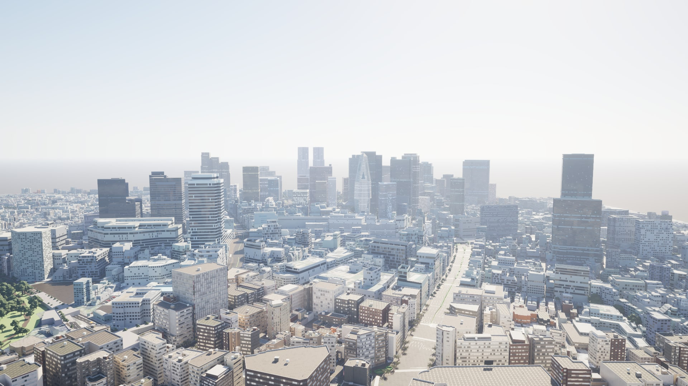
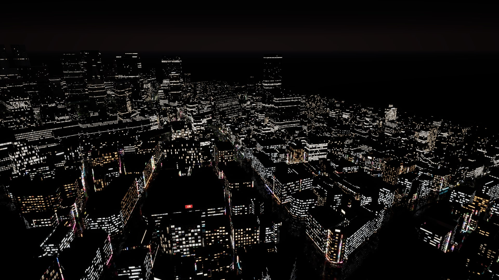

<h1 align="center">TokyoRT</h1>

<p align="center"><b>All of Shinjuku, streamed by level of detail around a camera you fly, path-traced in real time with <a href="https://github.com/meshy-dev/ThreeRT">ThreeRT</a>. No baked lighting.</b></p>

<p align="center">
  
</p>

Every building stands where it stands in Shinjuku: footprints, heights and uses come from Japan's open 3D city model
([Project PLATEAU](https://www.mlit.go.jp/plateau/)), streets and power lines from OpenStreetMap, the ground from GSI.
On top of that, rules written in TypeScript dress each building in a late-Shōwa look: tile-clad mixed-use blocks,
aluminium sashes, balconies and penthouses, shopfronts and fascias, sign towers, neon, and at street level the bars of
Golden Gai with their lightboxes, noren, lanterns, gas meters, crates and bicycles. 240 made-up shops each keep one
name across all their signs. Nothing is lit in advance: every light, shadow, reflection and bounce is traced as you fly.

<p align="center">
  
</p>

<sub>Frames of the offline path tracer (128–192 samples a pixel, denoised). The live view renders the same scene at
0.5–0.6 resolution scale with temporal accumulation: noisier in motion, the same light.</sub>

## Run it

macOS on Apple silicon (M3 or later: hardware ray tracing), [Rust](https://rustup.rs), [Node](https://nodejs.org) 24,
about 30 GB of disk and the system's Japanese fonts (Hiragino, drawn into the signs). Building everything takes
about 10 minutes on an M3 Max, plus the downloads (~1.5 GB from PLATEAU, OpenStreetMap, GSI and Poly Haven).

```bash
git clone --recursive https://github.com/threert/TokyoRT && cd TokyoRT
tools/setup.sh          # engine, downloads, the compiled city, its far level, every dressed cell
tools/demo.sh night     # or day / dusk; add a start point, e.g. tools/demo.sh night 360,-496
```

Click to capture the pointer (**Esc** lets go). **Mouse** to look, **W A S D** to move, **Space** / **E** up,
**C** / **Q** down, **Shift** faster, the **wheel** scales the speed. You start in a Golden Gai alley; fly up and out
over the city. The first frame takes 10–20 s.

`node tools/tour.ts tokyo-night-tour 90` flies a set path in the live view and prints its frame times;
`node tools/shot.ts` renders a still with the offline path tracer (as above).

## How it works

The city is three levels of detail, picked per 128 m cell by distance from the camera:

| level | where | what it is |
|---|---|---|
| far | always resident | PLATEAU's buildings as compiled (LOD2 blocks, photo roofs, window grids), the ground of every tile with its roads in scanned asphalt and pavers |
| mid (L1) | within ~480 m | each cell's buildings rebuilt from their footprints: windows by building, materials, bands and balconies, signs and sign towers, roofs with their tanks and air conditioners, trees |
| street (L0) | within ~140 m | the same buildings in full: doors and windows cut into the walls with depth, shops and bars, eaves, lanterns, noren, meters, pipes, utility poles and wires across the alleys, gutters, props |

- **Baking the cells** (`tools/tokyo/city-bake.ts`): the dressing rules (`scene/hero/dress.ts`) run once per cell and
  level and write what they make: meshes per material and the places of models and props. Shinjuku is 598 cells: 283 M
  triangles at street level, 74 M at mid distance.
- **Streaming** (`scene/city.game.ts`): the scene reads a cell's meshes as the camera nears it (`readAsset`, a range of
  the file at a time) and adds them in place, a frame budget of triangles at a time; the level it replaces goes
  afterwards, a few hundred objects a frame, and the far quadrant under it moves out of sight. The engine adds and
  removes them without rebuilding the scene: what that takes is in ThreeRT's
  [docs/RUNTIME.md, "Streaming"](https://github.com/meshy-dev/ThreeRT/blob/main/docs/RUNTIME.md).
- **The look** is rules, not hand placement: a style per building from its recorded use (shops, offices, flats, houses),
  one window module per building, scanned [Poly Haven](https://polyhaven.com) materials at their real size, signs and
  noren drawn per shop (`tools/tokyo/hero-shops.ts`), props built in code (`scene/hero/props.ts`: bicycles, scooters,
  vending machines, A-boards).

## What is precomputed, and what is not

**No lighting is baked.** There are no lightmaps, light probes, irradiance volumes, baked ambient occlusion or
precomputed shadows. Every frame the path tracer traces the sun or the night sky, every lit sign, lantern, window and
lamp, their shadows, reflections in the wet streets and glass, and the light bouncing between buildings. The radiance
cache the live view keeps is built from those paths as it runs and follows the scene as it changes. Day, dusk and night
are the same scene under another sky.

What is computed ahead is **geometry and textures**: the compiled city tiles, the far level's meshes, the dressed
cells, and the textures drawn for signs, lanterns, noren, menus and labels.

Two things worth saying alongside:
- **Photographs carry their own light.** The ground of the far level is GSI's aerial photograph and the far roofs are
  PLATEAU's photo atlases, so their texture shows the sunlight and shadows of the day they were taken (it reads from the
  air; near the camera the dressed levels replace them).
- **Far lights are seen, not sampled.** Lit windows and signs of the far level, and by night those of the mid level,
  are drawn unlit: they show their light and do not light their surroundings (light sampling is kept for the lights
  near the camera). Rooms behind frosted glass are emissive pictures of interiors, not modelled rooms.

## Performance

Measured on an M3 Max, flying the tour (`tools/tour.ts`, 90 s, streaming all the way): frame interval p50 20–23 ms and
p95 53–65 ms by night, 23 / 39 ms by day, at 0.5–0.6 resolution scale, with no scene rebuild. Flying slowly or standing
it holds 60 fps; fast flight still hitches now and then (a cell's lights added or removed rewrites the engine's light
list: the next thing to make incremental).

## Limits

- One area: Shinjuku (about 3.4 × 2.8 km). Shibuya and Shiba compile with the same pipeline but are not stitched in.
- No traffic or people yet; bicycles, scooters and vending machines are built in code, not scanned.
- For a few frames while a cell changes level both levels show (a flicker at ~140 m); the far level beyond ~480 m is
  PLATEAU's blocks as compiled.
- Shop names, shop layout and interiors are made up; the buildings, streets and terrain are real.

## Layout

```
scene/            the scene: city.game.ts (levels, streaming, the fly camera), sky.ts, hero/ (the dressing rules,
                  materials, props, shops)
tools/city/       the city compiler (PLATEAU / OSM / GSI -> 256 m tiles), from jeantimex/tokyo
tools/tokyo/      the far level (to-glb.ts --city), the cell baker, the drawn textures, the data prefetchers
tools/            setup.sh, demo.sh, tour.ts, shot.ts, bundle.ts, polyhaven.ts
engine/           ThreeRT (submodule): the renderer and the scene API
```

## Licences and credits

The code here is MIT (`LICENSE`). `tools/city` is from [jeantimex/tokyo](https://github.com/jeantimex/tokyo) (MIT, its
`LICENSE` kept).

The data is downloaded and built on your machine, not distributed here: 3D city model, Project PLATEAU (MLIT Japan,
CC BY 4.0); elevation and aerial photographs, Geospatial Information Authority of Japan (GSI); roads, rails and places
© OpenStreetMap contributors (ODbL; the compiled tiles and baked cells are a derived database under it). Materials and
models: [Poly Haven](https://polyhaven.com) (CC0).
